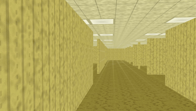
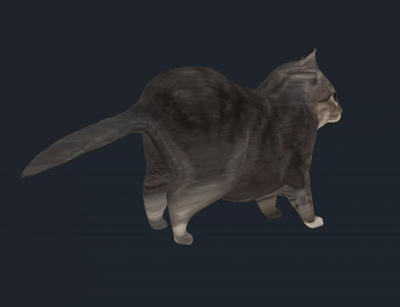
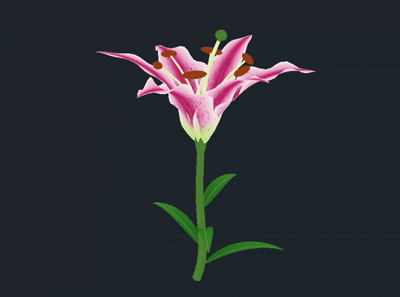

*This project has been created as part of the 42 curriculum by ayyassif.*

# SCOP

## Description

SCOP is a C++17 real-time 3D model viewer built with OpenGL. Its goal is to load an indexed Wavefront OBJ model and a P6 PPM image, prepare the mesh on the CPU, and display it in an interactive GLFW window.

The project includes:

- A manual OBJ parser for positions, texture coordinates, normals, polygon faces, negative indices, material-library names, and material assignments.
- CPU-side mesh construction with polygon triangulation and indexed vertex deduplication.
- Automatic planar UV chart generation for faces that do not provide texture coordinates.
- A binary P6 PPM loader with validation and image flipping for OpenGL texture coordinates.
- An OpenGL 3.3 renderer using VAOs, VBOs, an index buffer, GLSL shaders, depth testing, and mipmapped textures.
- Orbit and free-camera navigation, mouse look, scroll zoom, speed boost, and window resizing.
- Four render modes: solid color, texture, shades of grey, and UV chart colors.

Parsing and mesh processing use standard C++ and are kept separate from the OpenGL rendering layer. MTL filenames and material names are read from OBJ files, but MTL files are not currently parsed or applied to the rendered material; the supplied PPM argument is the texture used by the renderer.

## Requirements

The project is intended for Linux and requires:

- A C++17 compiler, such as `g++`
- GNU Make
- GLFW 3 development files
- OpenGL development files and a compatible OpenGL 3.3 driver
- Python 3 and `pip` only when the bundled GLAD files need to be generated

On Debian or Ubuntu, the system dependencies can be installed with:

```sh
sudo apt install build-essential libglfw3-dev libgl1-mesa-dev python3 python3-pip
```

## Instructions

Run commands from the repository root because the executable loads shaders using paths relative to the current working directory.

Build the project with:

```sh
make
```

If `glad/include/glad/glad.h`, `glad/include/KHR/khrplatform.h`, or `glad/src/glad.c` is missing, the Makefile attempts to install `glad==0.1.36` for the current user and generate the OpenGL 3.3 core loader automatically.

Launch the viewer with an OBJ file followed by a P6 PPM texture:

```sh
./scop path/to/model.obj textures/red.ppm
```

The same command can be run through Make:

```sh
make run ARGS="path/to/model.obj textures/red.ppm"
```

Useful build targets are:

```sh
make clean    # Remove object files and dependency files
make fclean   # Remove generated files and the executable
make re       # Clean and rebuild
```

The repository contains several PPM textures under `textures/` and sample OBJ/MTL assets under `resources/`. Run the viewer with one of the supplied OBJ files and a compatible PPM texture, or provide your own files.

## Controls

| Input | Action |
| --- | --- |
| `W` / `A` / `S` / `D` | Move or orbit the camera |
| `Space` / `Left Shift` | Move up / down |
| `Left Ctrl` | Hold for a camera speed boost |
| Mouse | Look around |
| Mouse wheel | Zoom in or out |
| `C` | Switch between Orbit and Free camera modes |
| `M` | Toggle Color and Texture modes |
| `N` | Toggle Shades of Grey and Chart Colors modes |
| `Tab` | Toggle mouse capture |
| `Esc` | Exit the application |

## Project Structure

- `src/parser/`: OBJ parsing, UV generation, and mesh construction
- `src/mesh/`: CPU-side vertex, mesh, and material data structures
- `src/math/`: vectors, matrices, and math helpers
- `src/Camera.*`, `src/Input.*`: camera movement and input handling
- `src/Scop.*`, `src/Shader.*`: OpenGL resources and the render loop
- `shaders/`: vertex and fragment GLSL programs
- `textures/`: P6 PPM texture assets
- `glad/`: generated OpenGL loader sources and headers

## Gallery

> **Note:** The GIFs below are compressed previews for demonstration purposes. They may not fully represent the original visual quality of the application.







### Teapot — Chart Colors

Each UV chart is displayed in a different color to visualize the texture mapping layout.


### Teapot — Face Colors

Faces are displayed with different colors to distinguish individual regions of the mesh.


### Teapot — Texture Mapping

The texture is applied to the teapot using its UV coordinates.


## Resources

Classic references used for the implementation and for understanding the topic:

- [LearnOpenGL: Getting Started](https://learnopengl.com/Getting-started/OpenGL)
- [Wavefront OBJ file](https://en.wikipedia.org/wiki/Wavefront_.obj_file)
- [Netpbm PPM format documentation](https://netpbm.sourceforge.net/doc/ppm.html)

