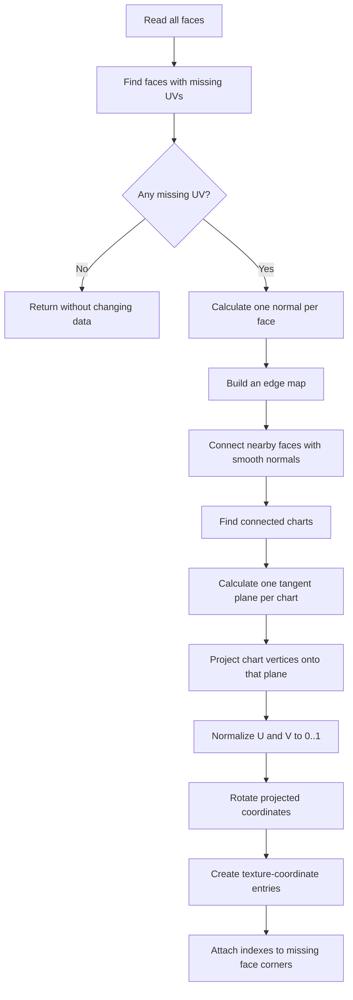

# UV Mapping in SCOP

## What this document explains

This document explains `parser/UVMapper.cpp` from the beginning. It assumes that you do not already know 3D graphics, UV mapping, vectors, or the mathematics used by the code.

The mapper has one main job:

> Take 3D points from an OBJ model and create 2D texture coordinates for faces that do not have them.

A 3D model lives in space. A texture is a flat image. UV mapping is the process of deciding which point in the image belongs to each point on the model.

The letters are called **U** and **V** instead of X and Y because X, Y, and Z are normally already used for 3D coordinates.

```text
3D model point                         2D texture point
        (x, y, z)       UV mapping           (u, v)
             ------------------------------>
```

In this file, the current implementation uses a **chart-based planar projection**. The file also contains a larger **LSCM** implementation, but that implementation is not currently called by `UVMapper::generate()`.

---

## 1. The data being changed

The important structures come from `parser/OBJTypes.hpp`.

### A position

A position is a point in 3D space:

$$
P = (x, y, z)
$$

For example:

```text
P = (2, 1, -3)
```

`OBJData::positions` stores all of these points.

### A texture coordinate

A texture coordinate is a point in 2D texture space:

$$
T = (u, v)
$$

Usually both values are in the range $0$ to $1$:

```text
(0, 0) ---------------- (1, 0)
  |                        |
  |       texture          |
  |                        |
(0, 1) ---------------- (1, 1)
```

`OBJData::texcoords` stores these coordinates.

The exact meaning of the vertical direction depends on how the texture is loaded and displayed. The mapper itself only creates numbers.

### A face corner

An OBJ face corner is an `OBJIndex`:

```cpp
struct OBJIndex
{
    int position = -1;
    int texcoord = -1;
    int normal = -1;
};
```

This is important: a face corner points to a position, and may point to a texture coordinate.

For example, a corner may mean:

```text
position 4, texture coordinate 9, normal 2
```

A missing texture coordinate is represented by an invalid index, normally `-1`.

The mapper does not create a texture coordinate for every position in the entire model. It creates coordinates only for missing corners in faces that need UVs.

---

## 2. The complete active algorithm

The active path in `UVMapper::generate()` is:



A **chart** is a group of faces that can share one local 2D projection. The current code tries to keep faces together when:

1. they share an edge, and
2. their normals are not too different.

---

## 3. Step one: finding missing UVs

The mapper first creates:

```cpp
std::vector<int> needsUV(data.faces.size(), 0);
```

There is one flag for each face.

For each corner in each face, it calls `validTexcoord()`:

```cpp
return index >= 0 && index < static_cast<int>(data.texcoords.size());
```

A texture-coordinate index is valid when it is inside the array.

A face needs UV generation when at least one of its corners has an invalid texture-coordinate index.

### Important behavior

If every face already has valid UVs, the function returns immediately:

```cpp
if (!anyMissing)
    return;
```

This means existing complete UV data is preserved.

If a face has some valid UVs and some missing UVs, only the missing corners are filled later. Existing corners are skipped.

### Why the mapper works per corner

OBJ files can reuse a 3D position while using different UVs at different corners. This is useful at a texture seam.

For example, the same 3D corner may appear twice:

```text
3D position 7 -> UV (0.0, 0.5) on one face
3D position 7 -> UV (1.0, 0.5) on another face
```

Those two UVs are different even though the position is the same. The current active projection groups by position inside a chart, so it is simple and consistent, but it cannot represent a separate seam for two missing corners of the same chart.

---

## 4. Step two: face normals

A **normal** is a direction that points away from a surface. It helps the mapper understand the orientation of a face.

The code computes a normal with the polygon version of **Newell's method**:

```cpp
normal += Vec3(
    (current.y - next.y) * (current.z + next.z),
    (current.z - next.z) * (current.x + next.x),
    (current.x - next.x) * (current.y + next.y)
);
```

For a simple triangle, a common normal formula is easier to see.

Given three points $P_0$, $P_1$, and $P_2$:

$$
E_1 = P_1 - P_0
$$

$$
E_2 = P_2 - P_0
$$

$$
N = E_1 \times E_2
$$

The symbol $\times$ means the **cross product**. It creates a vector perpendicular to both input vectors.

Then the vector is normalized:

$$
\hat{N} = \frac{N}{|N|}
$$

where $|N|$ is the vector length.

### What normalization means

Suppose:

$$
N = (0, 0, 10)
$$

Its length is $10$, so:

$$
\hat{N} = (0, 0, 1)
$$

The direction stays the same, but the length becomes $1$.

The code returns `(0, 0, 1)` for a degenerate face whose normal has zero length. A degenerate face has no useful surface direction, usually because its points are repeated or all lie on one line.

---

## 5. Step three: the edge map

Two faces are neighbors when they share an edge.

An edge is made from two position indexes. The code sorts the two indexes:

```cpp
const EdgeKey key{std::min(first, second), std::max(first, second)};
```

This makes the edge independent of direction.

Without sorting:

```text
edge (2, 5)
edge (5, 2)
```

would look like two different edges. After sorting, both become:

```text
edge (2, 5)
```

The map stores all faces that use each edge.

The mapper only uses an edge when exactly two faces are recorded for it. This naturally ignores boundary edges and non-manifold edges with more than two uses.

### Limitation of the current edge map

The map stores only face indexes, not the exact corner indexes that formed the edge. That is enough for the current smoothness test, because the current code only compares face normals. The unused `EdgeUse` structure suggests that an earlier or planned version intended to inspect UVs at both sides of an edge.

---

## 6. Step four: deciding whether neighboring faces are smooth

The code compares the normals of two neighboring faces with a dot product:

```cpp
const float dot = faceNormals[firstFace].dot(faceNormals[secondFace]);
```

For two unit normals $A$ and $B$:

$$
A \cdot B = |A||B|\cos(\theta)
$$

Because both normals are normalized, $|A| = |B| = 1$, so:

$$
A \cdot B = \cos(\theta)
$$

Here $\theta$ is the angle between the faces.

The mapper uses a chart angle of $55$ degrees:

```cpp
const float chartAngle = Math::radians(55.0f);
```

It connects faces when:

$$
A \cdot B \geq \cos(55^\circ)
$$

The approximate threshold is:

$$
\cos(55^\circ) \approx 0.574
$$

### Visual meaning

```text
Nearly flat surface:

       face A          face B
          /--------------/
         /              /
        /              /
       /--------------/

Normals point in similar directions.
They can share a chart.
```

```text
Sharp corner:

       face A
          /
         /
        /________ face B

Normals point in very different directions.
The edge becomes a chart boundary.
```

The 55-degree value is a design choice. A smaller angle creates more charts and more seams. A larger angle keeps more faces together but may create distortion when one flat projection is used over a curved surface.

### A useful normal example

For two identical unit normals:

$$
A = (0, 0, 1), \quad B = (0, 0, 1)
$$

$$
A \cdot B = 1
$$

For perpendicular normals:

$$
A = (1, 0, 0), \quad B = (0, 0, 1)
$$

$$
A \cdot B = 0
$$

For opposite normals:

$$
A = (0, 0, 1), \quad B = (0, 0, -1)
$$

$$
A \cdot B = -1
$$

So a larger dot product means the faces point more similarly.

---

## 7. Step five: building charts

After the adjacency list is built, the mapper searches for connected groups of faces.

This is a graph problem:

```text
face 0 ---- face 1 ---- face 2       chart 0

face 3 ---- face 4                    chart 1
```

Each face is a node. A shared smooth edge is a connection.

The code uses a stack-like vector named `queue`:

1. Start with one unvisited face.
2. Mark it as belonging to the new chart.
3. Put its neighbors into the vector.
4. Repeatedly remove a neighbor.
5. Add its unvisited neighbors.
6. Stop when no faces remain.

This is depth-first search in practice because the code uses `push_back()` and `pop_back()`.

### Why charts are useful

One flat projection works reasonably well for faces that are close to one plane. It works poorly when the surface bends sharply.

Charts divide the model into smaller regions that are more nearly flat:

```text
whole curved object:

       [ chart 0 ] [ chart 1 ]
      /-----------/-----------/
     / chart 2   / chart 3   /
    /-----------/-----------/
```

Each chart gets its own local coordinate system and its own UV range.

### Current chart behavior

Only faces with missing UVs are put in the edge map and chart search. Faces that already have complete UVs are not used to connect missing faces into charts.

That is a conservative choice: existing UVs are not changed.

---

## 8. Step six: choosing a local 2D coordinate system

For each chart, the code adds all face normals together:

```cpp
chartNormal += faceNormals[faceIndex];
```

Then it normalizes the result.

This gives an average chart direction:

$$
N_{chart} = \operatorname{normalize}(N_0 + N_1 + \dots + N_n)
$$

If the normals point in similar directions, their sum points in a useful average direction.

### Choosing a reference vector

The mapper chooses either the X axis or the Y axis as a reference:

```cpp
Vec3 reference = std::fabs(chartNormal.x) > std::fabs(chartNormal.y)
    ? Vec3(0.0f, 1.0f, 0.0f)
    : Vec3(1.0f, 0.0f, 0.0f);
```

The reason is to avoid choosing a reference vector too parallel to the chart normal. A vector parallel to the normal would produce a very small tangent after projection, which is numerically unstable.

### Projecting the reference onto the plane

The tangent is computed as:

$$
T = \operatorname{normalize}(R - N(N \cdot R))
$$

where:

- $R$ is the reference vector,
- $N$ is the chart normal,
- $N \cdot R$ is the dot product,
- $N(N \cdot R)$ is the part of $R$ pointing along the normal.

Subtracting that normal part leaves the part of $R$ lying on the chart plane.

This is called **projection onto a plane**.

Then the second in-plane direction is:

$$
B = N \times T
$$

The vectors now form a local coordinate frame:

```text
                 B (local V direction)
                 ^
                 |
                 |
                 o------> T (local U direction)
                /
               /
       chart plane in 3D
```

`T` is the local U direction and `B` is the local V direction.

---

## 9. Step seven: projecting 3D points into 2D

The chart first computes the average position of its unique vertices:

$$
C = \frac{1}{n}\sum_{i=0}^{n-1} P_i
$$

This is the centroid.

For each position $P$, it calculates:

$$
D = P - C
$$

`D` is the vector from the chart center to the point.

Then the 3D point becomes a 2D point by taking dot products with the local axes:

$$
U_{raw} = D \cdot T
$$

$$
V_{raw} = D \cdot B
$$

So:

$$
P \longrightarrow (U_{raw}, V_{raw})
$$

### Simple example

Suppose:

```text
D = (2, 3, 0)
T = (1, 0, 0)
B = (0, 1, 0)
```

Then:

$$
U_{raw} = (2,3,0) \cdot (1,0,0) = 2
$$

$$
V_{raw} = (2,3,0) \cdot (0,1,0) = 3
$$

The projected point is:

```text
(Uraw, Vraw) = (2, 3)
```

The dot product is useful here because it measures how much of a vector points in a chosen direction.

---

## 10. Step eight: normalizing the projected rectangle

The raw projected values are not necessarily in the $0$ to $1$ range. The code finds:

```text
minU, maxU, minV, maxV
```

For every raw point:

$$
U_{normalized} = \frac{U_{raw} - U_{min}}{U_{max} - U_{min}}
$$

$$
V_{normalized} = \frac{V_{raw} - V_{min}}{V_{max} - V_{min}}
$$

This maps the smallest value to $0$ and the largest value to $1$.

### Example

Suppose the U values are:

```text
2, 5, 8
```

Then:

```text
minU = 2
maxU = 8
rangeU = 6
```

For the point with U = 5:

$$
U_{normalized} = \frac{5 - 2}{8 - 2} = \frac{3}{6} = 0.5
$$

For the point with U = 8:

$$
U_{normalized} = \frac{8 - 2}{6} = 1
$$

For the point with U = 2:

$$
U_{normalized} = 0
$$

The same process is applied to V.

### Zero-size protection

If all projected U values are equal, then $U_{max} - U_{min}$ is zero. Division by zero would be invalid.

The code uses a small minimum range:

```cpp
const float rangeU = std::max(maxU - minU, 1.0e-4f);
```

This does not create real variation in a flat direction, but it keeps the computation finite.

---

## 11. Step nine: rotating the UVs

The active code changes normalized coordinates with:

$$
U' = 1 - V
$$

$$
V' = U
$$

In code:

```cpp
uvByPosition[positionIndex] = Vec2(1.0f - normalized.y, normalized.x);
```

This keeps the coordinates in the $0$ to $1$ square while changing their orientation.

### Important naming note

The source comment says:

```cpp
// Rotate the texture 90 degrees clockwise in UV space.
```

Under the usual mathematical convention where U points right and V points up, the transformation $(U,V) \mapsto (1-V,U)$ is normally described as a 90-degree counterclockwise rotation plus a translation into the unit square. Texture-image coordinates sometimes use a downward-pointing vertical axis, so the visual result can be described differently depending on the convention.

The formula is the reliable description of what the program does.

---

## 12. Step ten: creating and attaching new texture coordinates

The mapper keeps one new texture-coordinate index per position within the chart:

```cpp
std::map<int, int> texcoordIndexByPosition;
```

When a missing corner is encountered:

1. Look up its position index.
2. If this position has no generated texture coordinate yet, append a UV to `data.texcoords`.
3. Store the new texture-coordinate index.
4. Assign that index to the corner.

Existing texture coordinates are skipped:

```cpp
if (validTexcoord(data, corner.texcoord))
    continue;
```

This means a generated UV is shared by all missing corners with the same position inside that chart.

### Example

Before:

```text
face A: position 0 -> texcoord missing
face A: position 1 -> texcoord missing
face A: position 2 -> texcoord missing
```

After:

```text
texcoords[12] = generated UV for position 0
texcoords[13] = generated UV for position 1
texcoords[14] = generated UV for position 2

face A: position 0 -> texcoord 12
face A: position 1 -> texcoord 13
face A: position 2 -> texcoord 14
```

The mapper appends to the existing texture-coordinate vector. It does not overwrite old entries.

---

## 13. A complete small example

Imagine a square in the XY plane:

```text
3D points:
P0 = (0, 0, 0)
P1 = (1, 0, 0)
P2 = (1, 1, 0)
P3 = (0, 1, 0)
```

Its normal is approximately:

```text
N = (0, 0, 1)
```

A suitable local frame is:

```text
T = (1, 0, 0)
B = (0, 1, 0)
```

The centroid is:

$$
C = \left(\frac{0+1+1+0}{4}, \frac{0+0+1+1}{4}, 0\right)
  = (0.5, 0.5, 0)
$$

After projecting around the centroid, the raw points are:

```text
P0 -> (-0.5, -0.5)
P1 -> ( 0.5, -0.5)
P2 -> ( 0.5,  0.5)
P3 -> (-0.5,  0.5)
```

The raw ranges are:

```text
minU = -0.5, maxU = 0.5
minV = -0.5, maxV = 0.5
```

After normalization:

```text
P0 -> (0, 0)
P1 -> (1, 0)
P2 -> (1, 1)
P3 -> (0, 1)
```

After the source transformation $(U,V) \mapsto (1-V,U)$:

```text
P0 -> (1, 0)
P1 -> (1, 1)
P2 -> (0, 1)
P3 -> (0, 0)
```

The square is still inside the texture, but its orientation has changed.

---

## 14. What the unused LSCM code is trying to do

The top half of `UVMapper.cpp` contains another approach called **LSCM**, or **Least Squares Conformal Maps**.

The active `generate()` function does not call:

```cpp
solveLSCM()
fallbackParameterizeChart()
normalizeAndPackChart()
```

Therefore those functions currently do not affect the output.

They are still important to understand because they describe a more advanced intended design.

### Why planar projection is limited

A planar projection assumes a chart can be flattened onto one plane. Consider a cylinder:

```text
3D cylinder:                 Flat projection:
     ______                    __________
   /        \                  |          |
  |          |                 |          |
   \ ______ /                  |__________|
```

A single projection can stretch or overlap parts of a curved surface.

### What LSCM tries to preserve

LSCM tries to preserve local angles when flattening a surface. It does not promise that all lengths remain exact. The desired result is called **conformal**.

Informally:

```text
small shapes keep their local angles,
but their size may change.
```

For each triangle, LSCM creates two linear equations based on the Cauchy-Riemann conditions. The code builds these rows in `SparseRow` objects.

Each unknown vertex has two unknown values:

```text
unknown U
unknown V
```

If there are $n$ unknown vertices, the system has $2n$ variables.

The code then builds the normal equations:

$$
A^T A x = A^T b
$$

where:

- $A$ contains equation coefficients,
- $b$ contains fixed-anchor contributions,
- $x$ contains the unknown U and V values,
- $A^T$ means the transpose of $A$.

The normal equations convert a least-squares problem into a square system that can be solved.

### Why anchors are necessary

A surface parameterization can often be translated, rotated, or scaled without changing its shape. These freedoms are called **ambiguities** or **degrees of freedom**.

For example, these UV layouts describe the same shape:

```text
(0,0), (1,0), (0,1)

(10,20), (11,20), (10,21)
```

The second one is just translated.

The code chooses two anchor vertices to remove this ambiguity:

1. One anchor fixes the origin.
2. Another anchor fixes a baseline direction and length.

### The solver

`solveDenseSystem()` uses Gaussian elimination with partial pivoting.

At each column it:

1. Finds the row with the largest pivot value.
2. Swaps that row into place.
3. Eliminates values below the pivot.
4. Uses back-substitution to calculate the unknowns.

The pivot check prevents division by a number that is too close to zero.

### Atlas packing in the unused path

`normalizeAndPackChart()` divides the texture into a grid of cells:

```text
+---------+---------+
| chart 0 | chart 1 |
+---------+---------+
| chart 2 | chart 3 |
+---------+---------+
```

It scales each chart uniformly so its aspect ratio is not changed, then moves it into one cell. A uniform scale is important:

```text
uniform scale:       non-uniform scale:
  /------\             /----------\
  |      |             |          |
  \------/             \----------/
  shape stays similar  shape is stretched
```

The constant `atlasMargin` leaves space around chart edges.

### Current status of LSCM

At present, the LSCM path is a dormant implementation. Keeping it in the same file creates extra complexity and makes it harder to know which algorithm is actually running. A future cleanup should either:

- connect it to `generate()` with a tested fallback, or
- remove it and keep only the active planar mapper.

Do not remove it blindly if LSCM is planned for the next feature; remove it only when the design decision is clear.

---

## 15. Numerical safety used by the code

Computer calculations use floating-point numbers. Floating-point numbers are approximate, so comparisons with exact zero can be dangerous.

The file uses small values such as:

```cpp
1e-12
1e-14
1.0e-4f
```

These are called **epsilons** or tolerances.

### Why tolerances exist

Mathematically:

$$
0.1 + 0.2 = 0.3
$$

In binary floating point, the stored result may be slightly above or below $0.3$.

Instead of asking:

```text
is value exactly zero?
```

code often asks:

```text
is absolute(value) smaller than a tiny tolerance?
```

The active mapper uses a minimum projected range to avoid division by zero.

### Degenerate geometry

A triangle is degenerate when its area is zero or nearly zero. In the unused LSCM path, degenerate triangles are skipped because they cannot provide a stable 2D equation.

The active path still calculates a face normal fallback for degenerate faces. That keeps the algorithm running, but the resulting UVs for invalid geometry may not be meaningful.

---

## 16. Complexity and performance

Let:

- $F$ = number of faces,
- $E$ = number of edges recorded,
- $V$ = number of unique positions in a chart.

The broad active stages are approximately:

- face scanning: $O(F)$ plus the number of face corners,
- edge-map construction: $O(E \log E)$ with `std::map`,
- chart search: approximately $O(F + E)$,
- projection per chart: $O(V \log V)$ with the current `std::map` lookups,
- adding UVs: approximately linear in the number of missing corners.

The current code is likely fast enough for ordinary student-project OBJ files. The most expensive possible improvement would be replacing maps with vectors indexed by position, because OBJ position indexes are already integers.

---

## 17. Cleanup opportunities in the current file

These are the main cleanup items found during review.

### High priority: remove or connect the unused algorithm

The following code is not used by the current `generate()` function:

- `EdgeUse`
- `Chart`
- `ChartSolution`
- `chartNormal()` helper
- `faceNeedsUV()` helper
- `edgeCanBeSmooth()` helper
- `squaredDistance()` helper
- `cross2()` is used by the unused LSCM path and triangulation
- `triangulateFace()`
- `chooseAnchors()`
- `solveDenseSystem()`
- `solveLSCM()`
- `fallbackProjectVertex()`
- `fallbackParameterizeChart()`
- `appendChartUVs()`
- `normalizeAndPackChart()`
- constants used only by the LSCM path

The cleanest choices are:

1. Keep the current planar mapper and delete the unused LSCM implementation, or
2. Make `generate()` call LSCM and use planar projection only when LSCM fails.

Leaving both implementations present without a connection makes maintenance confusing.

### Medium priority: use `constexpr` for fixed constants

These values never change at runtime:

```cpp
const float chartAngle = ...;
const float atlasMargin = ...;
const double lscmEpsilon = ...;
const double solveEpsilon = ...;
```

They could be `constexpr` if the called expression is usable in a constant expression. At minimum, the names could follow a clear constant style such as `kChartAngle`.

This is a readability cleanup, not a behavior fix.

### Medium priority: calculate the threshold once

The active code calculates this inside the edge loop:

```cpp
const float threshold = std::cos(chartAngle);
```

It can be calculated once before iterating through the edge map. The result is the same, but the intent is clearer and repeated work is removed.

### Medium priority: replace integer flags with a clearer type

This:

```cpp
std::vector<int> needsUV(data.faces.size(), 0);
```

is used as a Boolean. A clearer option is:

```cpp
std::vector<bool> needsUV(data.faces.size(), false);
```

or:

```cpp
std::vector<char> needsUV(data.faces.size(), 0);
```

`std::vector<char>` avoids some of the unusual proxy behavior of `std::vector<bool>`.

### Medium priority: avoid maps for position-indexed data

The active path uses:

```cpp
std::map<int, Vec2> uvByPosition;
std::map<int, int> texcoordIndexByPosition;
```

A position index is already an integer from `0` to `data.positions.size() - 1`. Arrays or vectors can be simpler and faster:

```text
uvByPosition[positionIndex]
texcoordIndexByPosition[positionIndex]
```

This should be done only after validating position indexes and deciding how to represent an unassigned entry.

### Medium priority: reduce duplicated normal calculation

The function computes a normal for every face before charting. `projectFaceTo2D()` computes a face normal again when used by the dormant triangulation path.

If the LSCM code remains, pass already-computed normals into helpers or store them in a chart-related structure. If the LSCM code is removed, this duplication disappears automatically.

### Correctness consideration: validate direct `OBJData` callers

`OBJParser` validates face position indexes when it parses a file. However, `UVMapper::generate()` accepts an `OBJData&` directly. If another caller constructs invalid `OBJData`, expressions like:

```cpp
data.positions[corner.position]
```

can access outside the vector.

There are two reasonable designs:

- Document that `OBJData` must already be validated, or
- Add validation in `generate()` and throw a useful exception.

This matters because the repository guidance asks malformed input to produce clear errors.

### Correctness consideration: charts can contain projection overlap

A planar projection does not detect whether two different parts of a chart overlap after projection. Large or curved charts may produce overlapping UVs.

Possible future improvements include:

- smaller charts,
- LSCM with a tested fallback,
- overlap detection,
- an atlas packer that checks chart bounds.

These are features, not simple cleanup, so they should be separate from a refactoring-only change.

---

## 18. What the active mapper does well

The current active path has several good properties:

- It leaves complete existing UV data untouched.
- It handles models with no missing UVs quickly.
- It groups nearby faces into charts instead of projecting every face independently.
- It uses face normals to avoid connecting sharp corners.
- It keeps generated coordinates in the unit square.
- It reuses generated coordinates for repeated positions inside a chart.
- It uses small tolerances to avoid obvious division-by-zero problems.
- It does not depend on OpenGL for mesh processing.

The algorithm is simple and understandable, which is a good foundation before adding a more advanced unwrapping method.

---

## 19. Short glossary

**3D position**  A point `(x, y, z)` in model space.

**2D texture coordinate**  A point `(u, v)` in image space.

**Chart**  A connected group of faces that share a local parameterization.

**Centroid**  The average position of a collection of points.

**Cross product**  A 3D operation that creates a perpendicular vector.

**Dot product**  A multiplication-and-addition operation that measures alignment between vectors.

**Face normal**  A direction perpendicular to a face.

**LSCM**  A least-squares method that tries to preserve local angles while flattening a surface.

**Normalize**  Change a vector's length to `1` without changing its direction.

**Planar projection**  Flatten 3D points onto a chosen plane.

**UV seam**  A place where neighboring face corners use different texture coordinates.

**Vector length**  The size of a vector. For `(x, y, z)`:

$$
|V| = \sqrt{x^2 + y^2 + z^2}
$$

---

## 20. One-sentence summary

The active `UVMapper` finds faces missing texture coordinates, groups smooth neighboring faces into charts, projects each chart onto an averaged tangent plane, scales the result into the $0$ to $1$ texture square, rotates it, and assigns new UV indexes to the missing face corners; the file also contains an unused LSCM-and-atlas implementation that should eventually be either integrated or removed.
